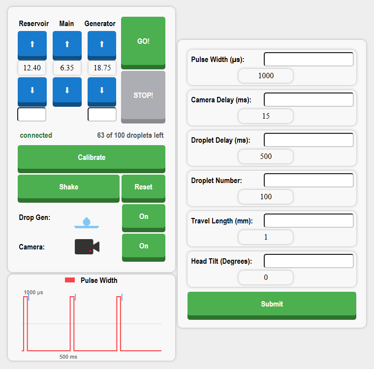

# DropGen: droplet-on-demand generator

[](LICENSE)
[](https://certification.oshwa.org/us002701.html)
[](https://platformio.org/)

Firmware and web interface for **DropGen**, a low-cost droplet generator for fluid-mechanics experiments. It was built in the Harris Lab at Brown University. DropGen dispenses single droplets from more than 1 mm down to under 0.2 mm in diameter. The droplets are precise and repeatable, and a camera can be triggered at the same moment of every drop.

The hardware is certified open source by the Open Source Hardware Association: **[OSHWA UID US002701](https://certification.oshwa.org/us002701.html)** (DropGen V3, certified November 2024). The body is 3D printed on an FDM printer around an off-the-shelf brass nozzle, and runs on a custom PCB.



## How it works

A fluid reservoir feeds a nozzle capped by a piezoelectric disc. A short voltage pulse flexes the disc, which pushes exactly one droplet out of the nozzle. The pulse width sets the droplet size. The reservoir's height sets the pressure at the nozzle, and a lead-screw stepper motor adjusts it.

```
            ┌──────── core 1 ────────┐        ┌──────────── core 0 ────────────┐
            │ drop generator task    │        │ web/control task               │
            │  pulse piezo (µs exact)│        │  HTTP server  (UI + buttons)   │
            │  trigger camera        │◄──────►│  WebSocket    (live state)     │
            │  count droplets        │ param  │  steppers     (AccelStepper)   │
            └────────────────────────┘        └────────────────────────────────┘
                     │ H-bridge                      │ step/dir      ▲ stall (DIAG)
                  piezo disc                 reservoir + generator motors
```

- **Precise timing.** The drop generator has a core of the ESP32-S3 to itself. Interrupts are disabled only for the microseconds of each pulse, so the pulse width doesn't jitter with Wi-Fi traffic, and the droplet period accounts for the camera delay.
- **Drive waveform.** The piezo sits across an H-bridge. Each droplet is one pulse of positive polarity, after which the bridge holds the opposite polarity until the next droplet. The UI graph draws exactly this waveform.
- **Camera sync.** Optionally, a 6 µs trigger pulse fires a set delay after each droplet, so a high-speed camera catches every drop at the same moment.
- **Motors.** Two lead-screw steppers (reservoir and generator head) at 1280 steps/mm, with acceleration profiles from AccelStepper. Their drivers' stall outputs are used for sensorless homing (*Calibrate*) and to stop a motor that hits something.
- **Persistence.** Every setting and motor position is saved to flash, so the device comes back up the way it was left.

## Web interface

The ESP32 serves the UI itself. On the lab network, open **http://dropgen.local**. If the network can't be joined within 20 s, the board starts its own Wi-Fi network, **DropGen**; join it and open **http://192.168.4.1**.

| Control | Does |
|---|---|
| Reservoir / Main / Generator ▲▼ | jog a motor (or both) by the travel length |
| GO! / STOP! | move to the positions typed under the arrows / decelerate to a stop |
| Calibrate | home both motors against their end stops |
| Shake | buzz the piezo for 3 s to clear bubbles from the nozzle |
| Reset | call the current position zero |
| Drop Gen | start a run of *Droplet Number* droplets, or stop it |
| Camera | trigger the camera after each droplet |
| Submit | send the settings on the right. An empty box keeps its current value |

Every open browser stays in sync: the device pushes its state over a WebSocket after each change, and five times a second while the motors move. The page reconnects by itself if the board restarts.

### Protocol

| Direction | Message |
|---|---|
| browser → device, HTTP `PUT` | `/genUP` `/genDOWN` `/resUP` `/resDOWN` `/mainUP` `/mainDOWN` `/go` `/stop` `/reset` `/calib` `/shake` `/dropgen` `/camera` |
| browser → device, WebSocket | `p<pulse µs>p<camera delay ms>p<droplet delay ms>p<droplets>p<travel mm>p<tilt °>p<reservoir mm>p<generator mm>` |
| device → browser, WebSocket | `drop camera pulse camDelay dropDelay dropNum travel tilt resPos genPos dropsLeft moving` (space-separated) |

The device validates and clamps every value it receives. A malformed settings message is rejected whole.

## Build and flash

The project uses [PlatformIO](https://platformio.org/) on a **Seeed XIAO ESP32-S3**.

```sh
pio run -t upload      # firmware
pio run -t uploadfs    # the web UI in data/ -> SPIFFS
pio device monitor     # prints the address to open
```

Wi-Fi credentials, pin assignments and limits are all in [`src/param.h`](src/param.h). The platform and library versions are pinned in [`platformio.ini`](platformio.ini).

| Pin | Use |
|---|---|
| 5, 4 | H-bridge inputs (piezo) |
| 6 | camera trigger |
| 7, 8 / 3, 2 | reservoir / generator stepper STEP, DIR |
| 9 / 44 | reservoir / generator driver stall output |
| 21 | on-board LED |

## Repository layout

| Path | Purpose |
|---|---|
| `src/Main.ino` | creates the two tasks and pins them to their cores |
| `src/Drop_Gen.*` | piezo pulses, droplet runs, camera trigger, shaking |
| `src/Motor_Cont.*` | steppers, jogging, homing, stall handling; positions in mm throughout |
| `src/Wifi_Cont.*` | Wi-Fi with access-point fallback, HTTP routes, WebSocket protocol |
| `src/param.h` | shared settings, limits, flash persistence |
| `data/` | the web UI (HTML, CSS, JS) served from SPIFFS |
| `docs/` | screenshots for this README |

## License

DropGen is certified open source hardware, [OSHWA UID US002701](https://certification.oshwa.org/us002701.html). The certification lists the hardware, software and documentation under the [Creative Commons Attribution-ShareAlike 4.0 International](https://creativecommons.org/licenses/by-sa/4.0/) license (CC BY-SA 4.0); the full text is in [`LICENSE`](LICENSE).

